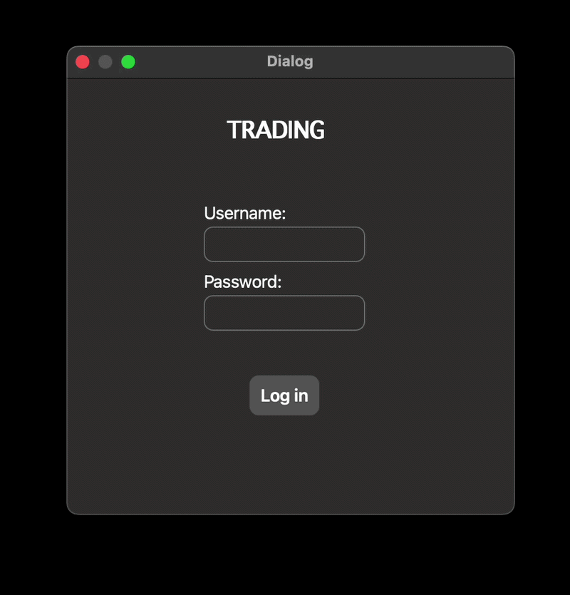

# Trading Application

A desktop **paper-trading and portfolio tracking application** built with **C++ and Qt 6**.

The project combines object-oriented C++, Qt Widgets, SQLite persistence and asynchronous HTTP requests to simulate a simple stock portfolio workflow.

Disclaimer: This project is a simulated trading application created for educational and portfolio purposes. It is not financial software and does not execute real trades.

## Demo



## Features

- Local user authentication with salted password hashing
- Persistent account and portfolio data with SQLite
- Automatic database schema initialization on first launch
- Local demo-data seeding for a fresh database
- Portfolio overview with owned shares, invested amount, current market price, and unrealized profit/loss
- Simulated buy and sell orders
- Atomic database updates for buy/sell operations using SQLite transactions
- Fractional share support
- Weighted-average cost-basis handling when shares are sold
- Live quote retrieval through the Twelve Data API
- Currency information returned with stock quotes
- Asynchronous networking with Qt Network
- Multi-window application flow using Qt signals and slots
- Dark desktop UI built with Qt Widgets and Qt Designer

## Tech Stack

- C++
- Qt 6: Widgets, SQL, Network
- SQLite
- CMake
- Twelve Data REST API

## Architecture

```text
AppFlow
├── LogInWindow
├── MainWindow
│   ├── Account
│   └── StockManager
├── OrderWindow
└── DBManager
```

**AppFlow** coordinates navigation and window lifetime and owns the shared `DBManager` instance used by the application.

**DBManager** owns the SQLite connection and handles authentication, schema initialization, data retrieval, and transactional persistence.

**Account** represents the currently logged-in account and its in-memory portfolio.

**StockManager** uses `QNetworkAccessManager` to retrieve quote data asynchronously.

**MainWindow** displays account information, holdings, live prices, and unrealized profit/loss.

**OrderWindow** handles stock lookup, share quantity input, order validation, estimated order value, and simulated buy/sell operations.

Database access is passed explicitly to the UI layer rather than retrieved through global state, keeping class dependencies visible.

## Application Flow

```text
Login
  ↓
Authenticate user
  ↓
Portfolio overview
  ↓
Buy / Sell Dialog
  ↓
Stock lookup
  ↓
Enter number of shares
  ↓
Validate order
  ↓
Persist transaction
  ↓
Update in-memory account
  ↓
Updated portfolio
```

## Market Data

Stock data is retrieved from the [Twelve Data API](https://twelvedata.com/).

API requests are asynchronous so the GUI remains responsive while market data is retrieved.

## API Key Setup

The application requires a personal Twelve Data API key to retrieve live stock data.

For security, the API key must **not** be hard-coded in the source code. Instead, the application reads the key from the `TWELVE_DATA_API_KEY` environment variable:

```cpp
QString apiKey = qEnvironmentVariable("TWELVE_DATA_API_KEY");
```

Before running the application, the `TWELVE_DATA_API_KEY` environment variable must be set. There are two ways to do this:

### Option 1: Terminal

On macOS/Linux, set the environment variable in the terminal:

```bash
export TWELVE_DATA_API_KEY="your_api_key"
```

The application can then be launched from the same terminal session.

### Option 2: Qt Creator

If the application is launched from Qt Creator, the environment variable can be configured directly in Qt Creator:

1. Open **Preferences → Environment → System**.
2. Under **Environment**, click **Change...**.
3. Add the following environment variable:

```text
TWELVE_DATA_API_KEY=your_api_key
```

4. Apply the changes and run the application from Qt Creator.

Replace `your_api_key` with your personal Twelve Data API key.


## Database

The application uses SQLite for local persistence.

On startup, the application automatically creates the required schema if the database does not already exist. A fresh database can also be populated with demo data for testing.

The database contains the following tables:

- `users`
- `accounts`
- `portfolios`

The database file is stored in the platform-specific application data directory using `QStandardPaths::AppDataLocation`, rather than inside the source repository. This avoids machine-specific absolute paths and keeps runtime data separate from source code.

### Authentication

Passwords are not stored in plain text.

For each user, the application stores:

- a password hash
- a unique password salt

The entered password is derived using PBKDF2 and compared with the stored hash during authentication.

### Transactional persistence

Buy and sell operations affect both the account balance and portfolio holdings. These related updates are executed inside a SQLite transaction so they are committed together.

If one database operation fails, the transaction is rolled back instead of leaving the database in a partially updated state.


## Portfolio Calculations

For each holding, the application stores the number of shares, the remaining investment/cost basis, and the currency.

```text
average buy price = cost basis / shares

current market value = shares × current price

unrealized P/L = current market value - remaining cost basis
```

When shares are sold, the remaining cost basis is adjusted using the weighted-average purchase price:

```text
cost basis of sold shares = sold shares × average buy price

realized P/L = sale proceeds - cost basis of sold shares
```

Sale proceeds are added to the account balance, while only the cost basis associated with the sold shares is removed from the holding.

Positive unrealized returns are displayed in green and negative returns in red.

## What I Practiced

- object-oriented C++ design
- `std::unique_ptr`
- const references and avoiding unnecessary container copies
- Qt parent-child ownership
- Qt signals and slots
- constructor-based dependency injection
- asynchronous REST API communication
- JSON parsing
- environment-based API key configuration
- SQL prepared statements and bound parameters
- SQLite persistence
- SQLite transactions and rollback handling
- automatic database schema initialization
- demo-data seeding
- password hashing and salting with PBKDF2
- platform-independent application data paths with `QStandardPaths`
- `QStandardItemModel`
- CMake
- Git feature-branch workflow

## Roadmap

- [ ] Improve API and database error handling
- [ ] Add unit tests for portfolio calculations
- [ ] Add trade history and realized profit/loss
- [ ] Improve cross-platform layout behavior
- [ ] Package the application for distribution

## Building

### Requirements

- CMake 3.19+
- Qt 6.5+
- C++17 or newer
- Qt SQLite driver
- Internet access for live market data

### Command line

```bash
git clone https://github.com/gabrielanik/trading_application.git
cd trading_application
cmake -S . -B build
cmake --build build
```

You can also open the repository directly in Qt Creator and select a Qt 6 kit.
